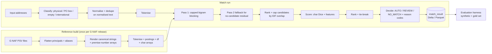

# `addrlink`: Address Matching — Paper Review, Research & Solution Specification

| | |
|---|---|
| **Status** | Draft v0.1 for review |
| **Date** | 2026-11-21 |
| **Basis** | Zhang, Churchill & Ng, *Exploiting Redundancy, Recurrency and Parallelism: How to Link Millions of Addresses with Ten Lines of Code in Ten Minutes*, AUSTRAC, [arXiv:1708.01402v4](https://arxiv.org/abs/1708.01402) (Jan 2018) |
| **Target platform** | Python package; primary engine Spark on Databricks, secondary engine DuckDB (local/CI) |
| **Primary use case** | Link Australian customer/operational addresses to G-NAF; secondarily link two arbitrary address datasets and de-duplicate within one |

---

## Contents

- [0. Executive summary](#0-executive-summary)
- **Part A — Review & research**
  - [1. Paper review](#1-paper-review)
  - [2. Critical assessment of the paper](#2-critical-assessment-of-the-paper)
  - [3. Wider research and what it changes](#3-wider-research-and-what-it-changes)
- **Part B — Solution specification**
  - [4. Scope, use cases and requirements](#4-scope-use-cases-and-requirements)
  - [5. Architecture](#5-architecture)
  - [6. Reference data: G-NAF](#6-reference-data-g-naf)
  - [7. Algorithm specification](#7-algorithm-specification)
  - [8. Configuration and presets](#8-configuration-and-presets)
  - [9. Engine implementation (Spark / DuckDB / Python oracle)](#9-engine-implementation)
  - [10. Data model and outputs](#10-data-model-and-outputs)
  - [11. Evaluation and tuning methodology](#11-evaluation-and-tuning-methodology)
  - [12. Non-functional design: scale, governance, privacy](#12-non-functional-design)
  - [13. Testing strategy](#13-testing-strategy)
  - [14. Delivery plan](#14-delivery-plan)
  - [15. Risks and open questions](#15-risks-and-open-questions)
  - [16. Prototype status and deviations](#16-prototype-status-and-deviations)
- [References](#references)
- [Appendix A — The paper's SQL, annotated](#appendix-a--the-papers-sql-annotated)
- [Appendix B — Reproducing the paper's scores](#appendix-b--reproducing-the-papers-scores)

---

## 0. Executive summary

**What the paper does.** AUSTRAC linked 48M messy government addresses to ~13M reference addresses (OpenAddresses AU, which is derived from G-NAF) in ~5 minutes on a 7-segment Greenplum cluster, **without parsing or standardising** the addresses. Each address is treated as a *bag of tokens*. **Round 1:** an inverted index over adjacent word pairs (bigrams) is built for each dataset. Pairs that occur in more than *k* = 100 addresses are discarded, and the two indexes are joined to produce candidate pairs. This is data-driven blocking. **Round 2:** each candidate pair is scored by a character-level set similarity and accepted above a threshold τ (best τ = 0.7). Manual review of 100 samples per experiment gave ~12% false positives at τ = 0.7 against the reference. When linking two raw datasets, 91% of links were correct (59/65), with a numeric-consistency rule added.

**What the review found** (§2):

1. **The similarity measure is Sørensen–Dice, not Jaccard.** The paper's worked example (6/8) and its linear-time algorithm compute Dice. Recomputing Table 2 confirms it: multiset Dice reproduces the printed scores with a mean error of 0.017; Jaccard does not (0.103). τ = 0.7 Dice ≈ 0.54 Jaccard. Implementing "Jaccard ≥ 0.7" literally would cost a lot of recall.
2. **Character bags ignore order.** UNIT 713, 731 and 317 at the same street number score identically (shown in the paper's own Table 1, and reproduced in our Spark prototype). Transposed unit or street numbers are a common and costly error, so ordered tie-breakers and numeric checks are mandatory.
3. **The evaluation is thin.** It rests on 100 manual samples per experiment, recall is not measured, and the 91% has a 95% CI of 81–96%. The paper also leaves 35% of queries unlinked in the two-dataset scenario.
4. **A hard cap of k = 100 on both sides can leave dense urban unit addresses with no candidates** against a 15.8M-row G-NAF: every bigram in "UNIT 1 10 GEORGE ST SYDNEY NSW 2000" is plausibly common. The input-side cap also penalises addresses that are popular in the input data, which is irrelevant when matching to a reference.

**What we will build.** `addrlink` is a Python package that implements the paper faithfully as a **baseline preset**, plus an **enhanced preset** whose additions are each switchable and must beat the baseline in a measured experiment:

- light, lossless token canonicalisation driven by the G-NAF authority tables (ST→STREET, NEW SOUTH WALES→NSW, U12→UNIT 12)
- reference-aware blocking: cap on reference frequency and on the df_q·df_r product, plus a residual "rarest-tokens / trigram" fallback pass for queries with no candidates
- **structure-aware numeric consistency.** The reference side's structure (unit, level, number, postcode) is known from G-NAF, so the raw side is never parsed.
- deterministic ordered tie-breakers (shared bigrams, Levenshtein)
- banded decisions (AUTO / REVIEW / NO_MATCH, plus NON_PHYSICAL for PO boxes) with reason codes for explainability
- an optional learned, calibrated scorer once clerically-reviewed labels exist

The core stays at roughly ten SQL statements, in Spark SQL (Databricks) and DuckDB SQL (laptop/CI). A pure-Python oracle backs the tests. Evaluation is upgraded with a **synthetic G-NAF corruption benchmark** (known ground truth, so recall is measured, including the blocking stage) and a **stratified clerical-review gold set** with confidence intervals.

---

# Part A — Review & research

## 1. Paper review

### 1.1 Context

Australian agencies link datasets on names and addresses. Name matching is well studied (Jaro-Winkler etc.); address matching is not, and the paper lists the address-specific problems: incompleteness, inconsistent formats ("unit 1 of 2 Elizabeth Street" = "1/2 Elizabeth St" = "U-1 2 Elisabeth Str"), errors (wrong street types, invalid or mismatched postcodes, misspellings) and unsegmented single-line text. The usual answer is to standardise first, i.e. parse into components and then canonicalise. The authors argue that **parsing is ambiguous** ("Service Centre St George" has at least four readings) and that **errors made in standardisation are unrecoverable** downstream.

### 1.2 Three ideas

| Idea | Meaning | Mechanism |
|---|---|---|
| **Redundancy** | An address is over-specified. Even without component labels and with errors, its tokens identify it uniquely, and true pairs stay more similar than non-pairs. | Treat the address as an unordered **bag (multiset) of tokens**; no parsing. |
| **Recurrency** | How often a token recurs across the database measures how well it discriminates. | **Data-driven blocking**: tokens that recur in more than *k* addresses are not used as blocking keys. |
| **Parallelism** | The whole algorithm is joins and aggregations. | ~10 SQL statements on an MPP engine (Greenplum; "straightforward" on Spark SQL / Hive / Impala). |

### 1.3 The algorithm, step by step

1. **Normalise:** upper-case; replace every run of non-`[A-Z0-9]` characters with a space. Nothing else (no abbreviation expansion, no parsing).
2. **Round-1 tokens (blocking):** *order-preserving adjacent word pairs*. "513 ELIZABETH ST MELBOURNE VIC 3000" → {513 ELIZABETH, ELIZABETH ST, ST MELBOURNE, MELBOURNE VIC, VIC 3000}. The SQL gets these by running a non-overlapping regex twice, once on the string and once with the first word removed (Appendix A).
3. **Inverted index per dataset:** token → list of address ids, with frequency (document frequency, df).
4. **Recurrence filter:** drop tokens with df > *k* in **either** dataset. The paper uses *k* = 100 on both sides, so at most 100 × 100 pairs are generated per token.
5. **Join the two indexes on token** and unnest to distinct candidate pairs (q, r).
6. **Round-2 similarity:** a character-level bag similarity between the two full strings. The paper calls it "Jaccard", but it is computed as Dice (§2.1). Round 1 uses *distinctive* tokens to decide which pairs are compared. Round 2 uses *tolerant* tokens (characters) to decide how similar they are. Formally, `d(x,y) = J_char(x,y) if J_phrase(x,y) > 0 else 0`.
7. **Decision:**
   - *Linking to a reference:* accept if score > τ. A τ sweep of {0.6, 0.7, 0.8} gave 0.7 as best.
   - *Linking two arbitrary datasets:* a fixed τ fails, because two different addresses on the same street can be each other's best match. Instead the **numeric tokens must be consistent**: one set of numeric tokens is a subset of the other. Walk the top 3 candidates in score order and take the first consistent one.
8. **Suggested but not implemented:** an edit-distance tie-breaker; Monge-Elkan as an alternative round-2 measure; averaging with a rule-based system.

### 1.4 Data and results

| Experiment | Data | Result (manual review of 100 random samples) |
|---|---|---|
| Reference linking | AGA1: ~48M raw addresses (mostly AU, poor quality) → OpenAddresses AU: "more than 19M" (body) / 13M (timing section) | τ=0.6: ~40% false. **τ=0.7: 12% false**, 2% "missed" relative to τ=0.6. τ=0.8: 31% missed. |
| Two raw datasets | AGA2: ~18M → AGA1: ~48M; numeric-consistency rule, top-3 | 59 true, 6 false, 35 not found → **precision 59/65 = 91%** |
| Runtime | Greenplum, 1 master + 7 segment hosts × 20 cores, 320 GB RAM | 48M × 13M ≈ **5 min**; 48M × 18M ≈ **7.5 min**; ~linear in nodes |

The authors note that runtime depends more on how *similar* the two databases are, i.e. on the number of shared distinctive tokens, than on their size. They frame the method in hindsight as a signature-based **set-similarity join** (Arasu, Ganti & Kaushik, VLDB 2006). They also list the approaches they abandoned: compressed sensing, matrix factorisation, KD-trees, Elasticsearch with custom rescoring, and rule-based expert systems.

---

## 2. Critical assessment of the paper

### 2.1 The "Jaccard index" is the Sørensen–Dice coefficient (verified)

- Eq. 1–2 define true Jaccard, |A∩B| / |A∪B| with |A∪B| = |A|+|B|−|A∩B|.
- The worked example counts {this, is, example} twice in the "intersection" (6) and sums both sets for the "union" (8). That is 2|A∩B| / (|A|+|B|), which is **Dice**.
- The "linear-time Jaccard" algorithm adds 2 to *common* and 2 to *total* on a match and 1 to *total* otherwise. Total ends as |A|+|B|, so this is also **Dice**.
- **Empirical check:** [`research/verify_similarity_metric.py`](../research/verify_similarity_metric.py) recomputes the paper's printed scores over alphanumeric characters. On Table 2, multiset Dice has a mean absolute error of **0.017** (max 0.046), against 0.103 for multiset Jaccard and 0.080 for set Jaccard. Table 1 fits no metric well, because its strings were heavily altered for privacy (Appendix B).

**Consequence:** we implement **multiset Dice over alphanumeric characters** and name it accordingly. Because J = D/(2−D), the paper's τ = 0.7 is Jaccard 0.54. A literal "Jaccard ≥ 0.7" implementation would really be applying Dice ≥ 0.82, close to the τ=0.8 setting where the paper lost 31% of links.

### 2.2 Character bags are order-blind

The paper's Table 1 shows "713 311 GUN HILNU ACT" tying at 0.93 with UNIT 731, 713 and 317 at the same street number. Any digit anagram ties, and so does any letter transposition in a name. Our Spark prototype ([`research/spark_prototype.py`](../research/spark_prototype.py)) reproduces the tie (0.889 vs 0.889). Ordered signals resolve it: shared bigrams (4 vs 3) and Levenshtein distance (6 vs 8). For a bank, linking a customer to the wrong unit in the right building is the most damaging kind of false positive, because it looks plausible. **Ordered tie-breakers and a numeric consistency check are therefore required, not optional.**

### 2.3 Evaluation is too thin to tune a production system

- 100 manual samples per experiment. The headline 91% is 59/65 with a Wilson 95% CI of **[81%, 96%]**.
- Recall is never measured. "Missed" in the reference experiment is relative to the τ=0.6 run, not to the truth.
- In the two-dataset experiment 35% of sampled queries were "not found". The usable link rate was 59%.
- Results are not broken down by address type (unit vs house vs rural vs PO box), and there is no separate measurement of how many true pairs blocking keeps (blocking recall).

### 2.4 The blocking rule has failure modes at G-NAF scale

- **Dense urban units.** In "UNIT 1 10 GEORGE ST SYDNEY NSW 2000", every adjacent bigram (UNIT 1, 1 10, 10 GEORGE, GEORGE ST, ST SYDNEY, SYDNEY NSW, NSW 2000) is plausibly above 100 occurrences in a 15.8M-row G-NAF. Such a query gets **zero candidates** and is silently unmatched. The paper's reference experiment could not observe this because recall was not measured.
- **The input-side cap is the wrong constraint for reference linking.** A token that is frequent in the *input* but rare in the *reference* is discarded; for example, many customers at a single large building all share "10 GEORGE". The cost of a token is df_q × df_r pairs, so capping that product bounds work without discarding such tokens.
- **Bigram order sensitivity.** "3000 VIC" vs "VIC 3000", or fields concatenated in a different order, change the bigrams. This is usually rescued by other bigrams, but not always.

### 2.5 Other gaps

- **A single fixed threshold** gives no confidence band, no clerical-review queue and no calibrated probability. A bank needs all three for governance.
- **Abbreviations cost score.** "ST" vs "STREET" loses 4 characters in Dice. The paper avoids standardisation because *parsing* is error-prone. A *token-level* synonym map (no parsing) is cheap, close to lossless, and worth testing.
- **Non-physical addresses** (PO Box, GPO Box, Locked Bag, Private Bag, Care PO) and **international addresses** are not handled. G-NAF contains no postal-delivery-only addresses, so these will always be false matches or noise.
- **Minor inconsistencies:** OpenAddresses is given as 19M in one section and 13M in another. The SQL in Appendix A has an extraction-garbled regex (a missing `^` anchor, a stray `+` in a character class).

### 2.6 What is worth keeping

The core is sound, simple and fast. It needs no parser or training data, it is robust to segmentation errors, it is explainable (shared tokens plus a score), and it is a natural fit for Spark. It also matches the general state of the art in set-similarity joins (§3.1). We keep the two-round structure exactly and harden the edges.

---

## 3. Wider research and what it changes

### 3.1 Set-similarity joins (the paper's own framing)

The paper's round 1 is a **signature-based set-similarity join** (Arasu et al. 2006). The literature since then is about choosing signatures well:

- **Prefix filtering** (AllPairs, PPJoin: Xiao et al. 2008). Sort each record's tokens by global rarity and index only the rarest *p*. For a threshold *t*, a prefix of |x| − ⌈t·|x|⌉ + 1 tokens guarantees no true pair is missed. An empirical evaluation (Mann, Augsten & Bouros, PVLDB 2016) found that simpler prefix-filter algorithms are competitive with more elaborate filtering schemes.
- **Distributed versions:** MapReduce PPJoin (Vernica, Carey & Li, SIGMOD 2010), and a Spark prefix-filter join designed to reduce PPJoin's duplicate generation (Zhu, Gagliardelli, Simonini & Beneventano, HPCS 2018). Recent work (FastScalableSparseJoiner, MIT 2024) uses "quasi-prefix filtering" to avoid processing the most popular elements, which is the same intuition as the paper's *k* cap.

**Design impact:** the paper's "drop tokens with df > k" is a frequency-ordered filter with a global cutoff. A per-record "keep my *m* rarest tokens" rule is the prefix-filter idea and **guarantees every record has signatures**. Our round-1 and round-2 token types differ, so the exactness guarantee does not carry over, but the coverage guarantee does. We adopt it as a **residual fallback pass** (§7.5) so that the worst-case pair count stays bounded.

### 3.2 Frequency weighting (TF-IDF, sparse cosine)

Weighting tokens by inverse document frequency is the standard upgrade from plain overlap. ING's open-source `sparse_dot_topn` matches company names using TF-IDF over character n-grams plus sparse top-n cosine. Its authors report that character 2/3-grams catch typos that word tokens miss, at a memory cost. Other work notes the flip side: n-gram similarity cannot connect abbreviations to their expansions ("OKC" vs "Oklahoma City"), because they share no n-grams. The paper's *k* cap is a binary IDF used only for blocking.

**Design impact:** add an **IDF-weighted word-token cosine** as a scoring feature, and use IDF overlap to rank and cap candidates. Keep character Dice as the primary score in the baseline. Abbreviations are handled by the synonym map (§7.2), not by n-grams.

### 3.3 Probabilistic record linkage (Fellegi–Sunter, Splink)

**Splink** (UK Ministry of Justice; Spark/DuckDB backends) implements Fellegi–Sunter with **term-frequency adjustments**: agreement on a rare value earns more weight. Its documentation notes that TF adjustment for array/token columns is not straightforward. The MoJ's **`uk_address_matcher`** (Linacre & Hepworth, IJPDS 2026) uses an ensemble: a Splink model to generate and score candidates, then a second pass that looks at **distinguishing tokens within each candidate group**. Its authors report about 177k messy addresses matched to 274k canonical ones in ~11 s.

**Design impact:**
- The "second pass within the candidate group" independently confirms that tie-breaking among near-identical candidates needs its own step (§7.7).
- For the optional learned scorer (§7.9), the features and the explainable logistic model below are the recommended first step. A Splink model is a reasonable later alternative if a feature-weight (m/u) formulation is preferred.

### 3.4 Parse-first approaches

- **libpostal** is a statistical (CRF) address parser and normaliser trained on OpenStreetMap/OpenAddresses. It is multilingual and has abbreviation expansion via `expand_address`. It is a heavy native dependency and its errors are hard to recover from downstream, which is exactly the paper's point.
- **ONS Address Index / AIMS** (UK) does parse → Elasticsearch candidate retrieval → scoring against AddressBase. It is a service architecture, not a batch join.
- **Febrl / Christen** used HMM-based standardisation, the approach the paper cites and moves away from.

**Design impact:** never parse the **raw** side. *Do* exploit the **reference** side's structure, which G-NAF provides for free (flat, level, number, street, locality, postcode). This gives structure-aware checks without parsing risk (§7.6). libpostal is out of scope for v1 and may be reconsidered for international addresses.

### 3.5 Neural approaches

- Siamese/bi-encoder transformers for address matching, e.g. Portuguese addresses with top-10 retrieval (arXiv 2307.02300, 2023), and GeoRoBERTa (2023).
- General linkage toolkits: LinkTransformer (2023), EnsembleLink (cross-encoder + LLM re-ranker, 2026).
- A 2024 economics review found models fine-tuned on modest labelled data performed best across linkage tasks.
- A 2025 clinical study found a hybrid rule-based/probabilistic approach more accurate *and* efficient for blocking than fine-tuned language models.

**Design impact:** out of scope for v1. Compute cost, model-risk governance and explainability burdens are high for a bank, and the residual these models would address is small and unknown until §11 measures it. Revisit as a **research track for the unmatched residual** once the benchmark exists (§14, M6).

### 3.6 Australian reference data and standards

- **G-NAF** (Geoscape, via data.gov.au) is Australia's authoritative physical address index, released quarterly. The Nov 2025 release has **15,827,416 addresses, 14,983,358 principal** (the rest are aliases). OpenAddresses AU, the paper's reference set, is derived from it.
- **Licence:** the Open G-NAF EULA is based on CC BY 4.0 **with an added restriction concerning use for sending mail**. The official fact sheet says G-NAF "is not suitable for sending mail". **Legal must confirm the bank's intended uses**, e.g. KYC/data-quality enrichment vs generating mailing addresses (§15).
- **G-NAF authority tables** (street type, street suffix, flat type, level type, state, etc.) supply the abbreviation vocabulary. Alias tables supply alternative street/locality names. The neighbour table supplies locality adjacency, which is useful for synthetic errors.
- **gnaf-loader** (minus34) is a mature open-source loader that flattens G-NAF into `address_principals` / `address_aliases` style tables and standardises authority tables to (code, name, description). We reuse its flattening logic as a reference, not as a dependency.
- **Standards:** AS 4590.1:2017 (client-information interchange; Section 5 aligned to AS/NZS 4819) and AS/NZS 4819:2011 (rural and urban addressing) define the element vocabulary: flat/level types, number ranges, street types and suffixes.

---

# Part B — Solution specification

## 4. Scope, use cases and requirements

### 4.1 Use cases

| ID | Use case | Priority | Notes |
|---|---|---|---|
| UC1 | **Reference linking:** raw addresses → G-NAF `address_detail_pid` (cleanse, geocode, enrich) | Must (v1) | The paper's §7.1 scenario. Structure-aware checks available. |
| UC2 | **Dataset-to-dataset linking:** two raw address datasets (e.g. two bank systems, or bank vs a third party) | Must (v1) | The paper's §7.2 scenario. Symmetric numeric subset rule. |
| UC3 | **De-duplication** within one dataset (self-join, i < j, plus clustering) | Should (v1.x) | Same core with a self-join and connected components. |
| UC4 | **Single-address lookup** (interactive or API) | Could (later) | A batch of one; needs a persisted index (§12.5). |

### 4.2 Functional requirements

| ID | Requirement |
|---|---|
| FR1 | Accept single-line or multi-field input. Multi-field input is concatenated in a configured canonical order. |
| FR2 | Produce the top-*K* candidates per input with score, rank, margin to the next candidate, features, decision band and reason codes. |
| FR3 | Support presets `paper` (faithful reproduction) and `enhanced`, plus per-parameter overrides. |
| FR4 | Classify non-physical (PO Box etc.), empty and likely-international inputs and route them to explicit outcomes instead of matching them. |
| FR5 | De-duplicate inputs on normalised text before matching, and fan results back out to all source rows. |
| FR6 | Build versioned reference artefacts once per G-NAF release and reuse them across runs. |
| FR7 | Record every run (config, config hash, code version, reference version, row counts, timings) for reproducibility. |
| FR8 | Ship an evaluation harness: a synthetic benchmark generator, gold-set metrics with CIs, and experiment comparison reports. |
| FR9 | Provide a CLI and a Python API. Both run the same code paths on Spark and DuckDB. |
| FR10 | Return the same results on both engines for the same input, config and reference (parity-tested). |

### 4.3 Non-functional requirements

| ID | Requirement | Initial target (to confirm, §15) |
|---|---|---|
| NFR1 | Scale | Full G-NAF × 20M distinct inputs end-to-end in ≤ 30 min on an agreed Databricks cluster; reference build ≤ 30 min |
| NFR2 | Determinism | Identical outputs for identical inputs/config/reference (total ordering on all ties) |
| NFR3 | Explainability | Every decision carries its score, features and reason codes; shared tokens are available for top-1 |
| NFR4 | Privacy | No data leaves the workspace; no external API calls; raw addresses never written to logs |
| NFR5 | Hot path | Pure SQL/array functions only; no row-at-a-time Python UDFs |
| NFR6 | Quality gates | Precision/recall thresholds enforced in CI on the synthetic benchmark (§13) |

### 4.4 Non-goals (v1)

Address parsing of raw input; postal deliverability validation (that needs the Australia Post PAF); international address matching; neural or LLM matching; a real-time service.

---

## 5. Architecture

### 5.1 Pipeline



### 5.2 Package layout

```
addrlink/
  pyproject.toml                # uv/pip; extras: [spark], [duckdb], [ml], [dev]
  src/addrlink/
    __init__.py                 # Matcher, MatchConfig public API
    config.py                   # pydantic models, presets, config hash
    api.py                      # Matcher: prepare_reference(), link(), dedupe()
    cli.py                      # `addrlink build-reference | match | evaluate | synth`
    normalise/
      rules.py                  # regexes, classifier for non-physical/international
      synonyms.py               # synonym map built from G-NAF authority tables + curated CSV
      data/synonyms_curated.csv
    reference/
      gnaf.py                   # load PSV, flatten principals/aliases, render strings
    engine/
      base.py                   # Engine protocol: run_stage(name, params) -> table
      spark/                    # Spark SQL templates (*.sql.j2) + session helpers
      duckdb/                   # DuckDB SQL templates (*.sql.j2)
      oracle.py                 # pure-Python reference implementation (tests, tiny jobs)
    scoring/
      features.py               # feature definitions (shared docs for SQL + oracle)
      decision.py               # band rules, reason codes
      learned.py                # optional logistic scorer + calibration ([ml] extra)
    evaluation/
      synth.py                  # G-NAF corruption generator
      metrics.py                # precision/recall/blocking recall, Wilson CIs
      sampling.py               # stratified gold-set sampling, review export/import
      report.py                 # experiment comparison (markdown/HTML)
  tests/ ...
  bundles/                      # Databricks job definitions (Asset Bundle or house standard)
```

### 5.3 Engine strategy

- **SQL templates per dialect, not a transpiler.** The stages are ~10 statements, as in the paper; that suits a SQL-strong team and keeps them auditable. The dialect differences are small but real. Verified in this review:
  - Lambdas: Spark `transform(xs, i -> ...)` vs DuckDB 2.x `list_transform(xs, lambda i: ...)`. DuckDB 2.x rejects the `->` lambda syntax by default.
  - Set intersection: `array_intersect` vs `list_intersect`.
  - Explode: `posexplode` / `LATERAL VIEW` vs `unnest` / `generate_subscripts`.
  - Spark's `sequence(0, -1)` returns `[0, -1]`, so single-word addresses must be guarded.
- **Python oracle:** the same algorithm in plain Python (`collections.Counter`, `rapidfuzz` for Levenshtein). It is the source of truth for the parity tests and handles tiny jobs without either engine.
- **Spark is primary** (Databricks, Unity Catalog, Delta). **DuckDB is secondary:** a single node handles full G-NAF comfortably, and it powers fast CI and offline experimentation.

### 5.4 Public API (sketch)

```python
from addrlink import Matcher, MatchConfig

cfg = MatchConfig.preset("enhanced").override(decision={"tau_auto": 0.82})
m = Matcher(engine="spark", spark=spark, config=cfg)

ref = m.reference("main.addrlink.gnaf_2025_11")           # prebuilt artefacts (FR6)
res = m.link(spark.table("main.cust.addresses"),            # UC1
             ref, id_col="customer_address_id",
             address_cols=["line1", "line2", "suburb", "state", "postcode"])
res.write("main.addrlink.match_result")                     # + run_log row (FR7)

m.link_datasets(df_a, df_b, ...)                            # UC2
m.dedupe(df, ...)                                           # UC3
```

---

## 6. Reference data: G-NAF

### 6.1 Build

1. Load the G-NAF PSV release into bronze tables in a Unity Catalog volume, keeping `gnaf_version`.
2. Flatten to one row per address: `address_detail_pid`, `flat_type`, `flat_number(+prefix/suffix)`, `level_type`, `level_number`, `number_first(+suffix)`, `number_last(+suffix)`, `lot_number`, `building_name`, `street_name`, `street_type`, `street_suffix`, `locality_name`, `state_abbreviation`, `postcode`, `is_principal`, `street_locality_pid`, `locality_pid`, and geocode.
3. **Render a canonical string** for each address using full forms:
   `[FLAT_TYPE FLAT_NO] [LEVEL_TYPE LEVEL_NO] [NUMBER_FIRST[-NUMBER_LAST] | LOT LOT_NO] STREET_NAME STREET_TYPE [SUFFIX] LOCALITY STATE POSTCODE`.
   Building name is excluded by default (a variant option, tested in §11).
4. **Variants:** a principal address plus alias rows (street/locality aliases, alias addresses) all map to the same principal PID. Scoring takes the best variant per PID.
5. **Premise-number array** per row from the structured fields: `{flat_no, level_no, number_first, number_last, lot_no}` (non-null, normalised such as `12A`), plus `postcode`. This drives §7.6.
6. Precompute the reference-side artefacts (tokens, postings, df, char arrays, IDF) and store them in Delta under `<catalog>.addrlink.ref_<gnaf_version>_*`.

### 6.2 Synonym vocabulary

The synonym vocabulary is built from G-NAF authority tables, using both columns: street type, street suffix, flat type, level type, and state names ↔ abbreviations. A small curated CSV adds common non-standard variants (STR, STRT, STREET → ST; AV, AVENUE → AVE; CRES; CRT/CT; HWY; U, UNIT; APT; L, LVL, LEVEL; NTH/STH/EST/WST; MT, MOUNT; QUEENSLAND → QLD).

**The canonical target is the short form, applied identically to both sides.** STREET → ST, AVENUE → AVE, NEW SOUTH WALES → NSW. Mapping many-to-one onto the abbreviation removes the classic ambiguity: SAINT and STREET both become ST on both sides, so no context rule is needed. It also shortens the common "boilerplate" tokens, which makes character Dice relatively more sensitive to the parts that discriminate, i.e. names and numbers.

---

## 7. Algorithm specification

Notation: Q is the query (input) set, R the reference set, df_Q(t) and df_R(t) are document frequencies, and N_R = |R|.

### 7.1 Stage 0 — Input classification

| Class | Rule (regex on upper-cased text, configurable) | Outcome |
|---|---|---|
| EMPTY | No alphanumerics after normalisation | `decision = EMPTY` |
| NON_PHYSICAL | `\b(PO\|P O\|GPO\|LOCKED\|PRIVATE)\s*(BOX\|BAG)\b`, `\bCARE\s+PO\b`, `\bRMB\b` (configurable) | `decision = NON_PHYSICAL`, not matched |
| LIKELY_INTERNATIONAL | No AU state token and no 4-digit token, and/or a country token not equal to AUSTRALIA | `decision = OUT_OF_SCOPE` (flagged; matching can optionally still run) |
| PHYSICAL | Otherwise | Continue |

### 7.2 Stage 1 — Normalisation

| Step | `paper` | `enhanced` |
|---|---|---|
| Unicode NFKD → ASCII, upper-case | upper only | ✓ |
| `[^A-Z0-9]+` → single space, trim | ✓ | ✓ |
| Drop noise tokens (`C/O`, `ATTN`, `AUSTRALIA` at end) | – | ✓ |
| Split glued unit/level prefixes: `^(U\|UNIT\|APT\|FLAT\|L\|LVL\|LEVEL\|SHOP\|SE\|SUITE)(\d+[A-Z]?)$` → two tokens | – | ✓ |
| Token synonym canonicalisation (§6.2), **applied to both sides** | – | ✓ |
| Collapse immediate duplicate tokens (`QLD QLD`, `VIC VIC`) | – | ✓ |

Synonym rules are **token → token** substitutions onto the short form (§6.2); there is no parsing and no reordering. Ambiguity is therefore harmless: STREET and SAINT both become ST on both sides. Multi-word phrases (e.g. NEW SOUTH WALES → NSW) come from an explicit phrase list and are matched longest-first. Every rule is applied identically to both sides, so a rewrite inside a name (e.g. NORTH SYDNEY → N SYDNEY) is harmless. The aim is to remove systematic score penalties (e.g. "ST" vs "STREET" costs ~4 characters in Dice), not to standardise. **Each rule is an experiment (§11.4); a rule that does not improve the benchmark is switched off.**

Each input row gets `norm` (normalised text) and `norm_key = sha2(norm, 256)`. Matching runs on **distinct `norm_key`** (FR5).

### 7.3 Stage 2 — Tokenisation

For each normalised address:

- `words`: split on space.
- **Blocking tokens, pass 1:** ordered adjacent word bigrams. The option `bigram_mode = unordered` sorts each pair (`VIC 3000` ≡ `3000 VIC`).
- **Blocking tokens, pass 2 (fallback only):** adjacent word trigrams + bigrams.
- `chars`: **occurrence-indexed character multiset** over `[A-Z0-9]` (spaces excluded). For example, `EEL` → `{E#1, E#2, L#1}`. With this encoding, *set* intersection on arrays equals *multiset* intersection, so the engines' native `array_intersect` computes multiset Dice without UDFs (verified on Spark and DuckDB).
- `nums`: tokens containing a digit (e.g. `713`, `12A`, `3216`).

### 7.4 Stage 3 — Pass-1 blocking (recurrence-capped bigrams)

Postings `(addr_id, token)` are distinct per address. Then:

```
paper:     keep token t  iff  df_Q(t) ≤ k  AND  df_R(t) ≤ k                    (k = 100)
enhanced:  keep token t  iff  df_R(t) ≤ k_R AND df_Q(t) · df_R(t) ≤ P_max     (k_R = 100, P_max = 10 000)
```

The enhanced rule keeps the paper's worst case of 10,000 pairs per token, but no longer discards tokens that are frequent only in the input (§2.4). For UC2 and UC3, where both sides are raw, the paper rule is used. The candidate pair set is

`cand = {(q, r, shared_blocks = |B(q) ∩ B(r)| over kept tokens, idf_overlap = Σ_{t ∈ B(q) ∩ B(r)} ln(N_R / df_R(t)))}`.

### 7.5 Stage 4 — Pass-2 fallback (enhanced only)

**Residual** = queries with no pass-1 candidate. For these only:

1. Use pass-2 tokens (bigrams + trigrams) and look up df_R.
2. Keep each query's *m* rarest tokens with df_R ≤ K_max (defaults *m* = 3, K_max = 2,000). This is the prefix-filter idea from §3.1 and guarantees coverage.
3. Join to the reference postings and add the resulting candidates, flagged `blocking_pass = 2`.

The cost is bounded by |residual| × m × K_max before capping. The size of the residual is a reported metric; if it is large, the pass-1 parameters are wrong.

### 7.6 Stage 5 — Candidate capping and scoring

**Cap:** keep the top `max_candidates` per query (default 200) by `(idf_overlap DESC, shared_blocks DESC, r_id)`. This bounds the work for "hub" queries.

**Primary score (both presets):**

```
dice_char(q, r) = 2 · |C(q) ∩ C(r)| / (|C(q)| + |C(r)|)      # C = occurrence-indexed char multiset
```

**Features** (enhanced; computed on capped candidates; some only on the top-K after ranking):

| Feature | Definition | Purpose |
|---|---|---|
| `shared_blocks` | Number of shared kept bigrams | Ordered signal; tie-breaker |
| `lev_ratio` | 1 − levenshtein(norm_q, norm_r) / max(len) | Ordered signal; tie-breaker (the paper's suggestion) |
| `word_idf_cosine` | Cosine over word sets weighted by idf_R (unseen words get ln N_R) | Rare-word agreement (§3.2) |
| `numeric_status` | See below | Wrong-unit / wrong-number protection |
| `postcode_status` | `MATCH` / `MISMATCH` / `ABSENT` | Postcode typos are not fatal, just evidence |
| `state_status` | `MATCH` / `MISMATCH` / `ABSENT` | Same |
| `margin` | Score(rank 1) − score(rank 2) among non-conflicting candidates | Ambiguity |
| `n_candidates`, `blocking_pass` | | Diagnostics |

**`numeric_status` in UC1 (structure-aware; no parsing of the input).** Let P_r be the reference premise-number set (§6.1 step 5) and pc_r the reference postcode. Let N_q be the query's numeric tokens with two removals:

- pc_r, if present;
- the query's *own* postcode candidate, i.e. a 4-digit token that is the last token or immediately follows a state token. This token is compared with pc_r for `postcode_status`, so a mistyped postcode becomes evidence rather than a numeric conflict. This is a positional heuristic, not a parse. Mid-string 4-digit street numbers such as `3345` are unaffected.

| Status | Condition | Meaning |
|---|---|---|
| `EXACT` | P_r ⊆ N_q and N_q ⊆ P_r | Every number agrees |
| `QUERY_LESS_SPECIFIC` | N_q ⊂ P_r (e.g. query lacks the unit number) | Building-level match only |
| `QUERY_MORE_SPECIFIC` | P_r ⊂ N_q (e.g. query has a unit and the reference row does not) | A more specific reference row may exist; it should outrank this one |
| `CONFLICT` | Neither is a subset | Wrong unit or number; never AUTO |

`number_last` (the end of a range) is treated as optional on the query side.

**`numeric_status` in UC2/UC3 (the paper's rule):** `CONSISTENT` iff N_a ⊆ N_b or N_b ⊆ N_a, otherwise `CONFLICT`. Optionally, a trailing 4-digit token that both sides share is excluded first.

### 7.7 Stage 6 — Ranking and tie-breaking

Total order per query (deterministic, NFR2):

```
ORDER BY (numeric_status = 'CONFLICT') ASC,   -- conflicting candidates sink
         dice_char DESC,
         shared_blocks DESC,
         lev_ratio DESC,
         word_idf_cosine DESC,
         r_id ASC
```

In the `paper` preset the order is `dice_char DESC, r_id ASC`. For UC2 the paper's rule is applied: walk the top 3 and pick the first `CONSISTENT` candidate. `margin` and a `tie_broken_by` reason code record which key settled rank 1.

### 7.8 Stage 7 — Decision

**`paper` preset:**
- UC1: `MATCH` if `dice_char > τ` (τ = 0.70), else `NO_MATCH`.
- UC2: `MATCH` if a `CONSISTENT` candidate exists in the top 3, else `NOT_FOUND`.

**`enhanced` preset (rules; thresholds are starting hypotheses to be tuned in §11):**

| Decision | UC1 rule |
|---|---|
| `AUTO_MATCH` | `dice_char ≥ τ_auto` (start 0.80) ∧ `numeric_status = EXACT` ∧ `postcode_status ≠ MISMATCH` ∧ (`margin ≥ δ` (start 0.02) ∨ the tie was resolved by an ordered key) |
| `REVIEW` | Not AUTO ∧ `dice_char ≥ τ_review` (start 0.65) ∧ `numeric_status ≠ CONFLICT` |
| `PARTIAL_MATCH` | Best candidate is `QUERY_LESS_SPECIFIC` with `dice_char ≥ τ_review`. Emit street-locality / locality-level linkage (`match_level = STREET` or `LOCALITY`), which is still useful for geocoding. |
| `NO_MATCH` | Otherwise |

Every row carries `reason_codes` (an array), for example `NUM_EXACT`, `NUM_CONFLICT`, `POSTCODE_MISMATCH`, `LOW_MARGIN`, `TIE_BROKEN_BY_BLOCKS`, `TIE_BROKEN_BY_LEV`, `FALLBACK_BLOCKING`, `NO_CANDIDATES`, `CAPPED`.

### 7.9 Stage 7b — Optional learned scorer (after a gold set exists)

- **Model:** L2 logistic regression on the §7.6 features plus interactions with the numeric/postcode statuses. It is explainable through its coefficients, which suits bank model-risk processes. Upgrade to gradient boosting only if it wins clearly on held-out gold data.
- **Calibration:** isotonic or Platt calibration on a held-out fold. The bands become probability thresholds chosen to meet the agreed precision on AUTO (§11.5).
- **Labels:** from the clerical-review loop (§11.2), with active sampling near the decision boundary.
- **Same features on both engines:** the model is exported as coefficients and evaluated in SQL, so there is no Python UDF in the hot path.

### 7.10 UC3 de-duplication

Self-join of the postings with `q_id < r_id`, the paper's frequency rule on a single df, and the UC2 decision rules. Clusters are the connected components of the AUTO edges, via GraphFrames on Spark or iterative SQL label propagation. A guard rule breaks up clusters whose diameter exceeds a limit (protection against transitive chaining).

### 7.11 Complexity

- Pass 1 pairs ≤ Σ_t df_Q(t)·df_R(t) over kept tokens ≤ |T_kept| · P_max. In practice the count is driven by shared rare tokens, not by dataset size (the paper's observation).
- Pass 2 pairs ≤ |residual| · m · K_max.
- After capping, scoring is O(|Q_distinct| · max_candidates · ~40) for character arrays of ~30–50 elements.
- Skew is bounded by construction: no token contributes more than P_max pairs.

---

## 8. Configuration and presets

```yaml
# addrlink config (pydantic-validated; hashed into run_log.config_hash)
preset: enhanced            # paper | enhanced
mode: reference             # reference (UC1) | datasets (UC2) | dedupe (UC3)
input:
  address_cols: [line1, line2, suburb, state, postcode]   # concatenated in this order
normalise:
  ascii_fold: true            # paper: false
  drop_noise_tokens: true     # paper: false
  split_glued_prefixes: true  # paper: false
  synonyms: gnaf_authority+curated   # paper: none
  collapse_duplicate_tokens: true    # paper: false
blocking:
  bigram_mode: ordered        # ordered | unordered
  rule: product               # paper: both_sides
  k: 100                      # paper: df_Q <= k AND df_R <= k
  k_ref: 100                  # enhanced: df_R <= k_ref
  p_max: 10000                # enhanced: df_Q * df_R <= p_max
  fallback: {enabled: true, tokens: [bigram, trigram], m: 3, k_max: 2000}   # paper: disabled
  max_candidates: 200         # paper: unlimited
scoring:
  primary: char_dice          # char_dice | char_jaccard (kept for experiments)
  alphabet: "[A-Z0-9]"
  features: [shared_blocks, lev_ratio, word_idf_cosine, numeric_status, postcode_status, state_status]
decision:
  method: bands               # paper: threshold | bands | learned
  tau: 0.70                   # paper threshold (Dice units)
  tau_auto: 0.80
  tau_review: 0.65
  min_margin: 0.02
  top_n_numeric: 3            # UC2 paper rule
output:
  keep_top_k: 3
  emit_shared_tokens_for_top1: true
```

Validation rules: thresholds are always in **Dice units**, and if `scoring.primary = char_jaccard` the validator converts them with J = D/(2−D) and warns. `k`, `p_max` and `k_max` are positive, and `p_max ≥ k`.

---

## 9. Engine implementation

### 9.1 Spark / Databricks

- **Hot path:** Spark SQL built-ins only (`regexp_replace`, `split`, `transform`, `sequence`, `posexplode`, `array_intersect`, `levenshtein`, window functions). No Python UDFs (NFR5).
- **Reference artefacts** are persisted per G-NAF version as Delta tables, with postings clustered on `token` (liquid clustering or Z-order, per house standard). df tables are small enough to join cheaply.
- **Inputs** are deduplicated on `norm_key` before tokenisation, and results are joined back afterwards (FR5). This is usually a large saving on customer data, where many rows share a few strings.
- **Joins:** postings ⋈ df (filter first), then postings ⋈ postings on `token`. Leave AQE and skew-join handling on; the frequency cap already bounds skew. Candidate aggregation is a `GROUP BY (q_id, r_id)`. The per-query cap uses `row_number()`.
- **Round-2 scoring** joins candidates to the query char arrays (on `q_id`) and the reference char arrays (on `r_id`). These are the two biggest shuffles; candidate capping before this step is what keeps them small.
- **Incremental runs:** new or changed `norm_key`s only. The reference side is reused until the next G-NAF release. A G-NAF release triggers a full re-match, plus a diff report of changed decisions.

### 9.2 DuckDB

The same stages and the same templates, with the dialect differences from §5.3. The target is full G-NAF × a few million inputs on a single node, used for development, CI benchmarks and offline experiments.

### 9.3 Python oracle

A straightforward implementation with `Counter`s and dicts. It is used for unit and parity tests and to explain individual decisions (`addrlink explain "<address>"`).

### 9.4 Core statements (Spark SQL, verified on PySpark 4.x in this review)

The `paper` preset's core, executed in [`research/spark_prototype.py`](../research/spark_prototype.py). Sides are `q` and `r`; S1–S3 and S5 run for both.

```sql
-- S1  normalise, words, ordered adjacent bigrams (guard: Spark sequence(0,-1) = [0,-1])
CREATE OR REPLACE TEMP VIEW q_tok AS
SELECT addr_id, norm, words,
       CASE WHEN size(words) > 1
            THEN transform(sequence(0, size(words) - 2), i -> concat(words[i], ' ', words[i + 1]))
            ELSE array() END AS bigrams
FROM (SELECT addr_id, norm, split(norm, ' ') AS words
      FROM (SELECT addr_id, trim(regexp_replace(upper(address), '[^A-Z0-9]+', ' ')) AS norm
            FROM q_input)
      WHERE norm <> '');

-- S2  postings (inverted index, long form)
CREATE OR REPLACE TEMP VIEW q_post AS
SELECT DISTINCT addr_id, token FROM q_tok LATERAL VIEW explode(bigrams) t AS token;

-- S3  document frequency
CREATE OR REPLACE TEMP VIEW q_df AS SELECT token, count(*) AS df FROM q_post GROUP BY token;

-- S4  candidates: join inverted indexes on recurrence-capped tokens (paper rule, k = 100)
CREATE OR REPLACE TEMP VIEW cand AS
SELECT qp.addr_id AS q_id, rp.addr_id AS r_id, count(*) AS shared_blocks
FROM q_post qp
JOIN q_df qd   ON qd.token = qp.token AND qd.df <= 100
JOIN r_df rd   ON rd.token = qp.token AND rd.df <= 100
JOIN r_post rp ON rp.token = qp.token
GROUP BY qp.addr_id, rp.addr_id;

-- S5  occurrence-indexed char multiset (E#1, E#2, ...) => set ops == multiset ops
CREATE OR REPLACE TEMP VIEW q_chr AS
SELECT addr_id, collect_list(concat(ch, '#', k)) AS chars
FROM (SELECT addr_id, ch, row_number() OVER (PARTITION BY addr_id, ch ORDER BY pos) AS k
      FROM (SELECT addr_id, posexplode(split(replace(norm, ' ', ''), '')) AS (pos, ch) FROM q_tok)
      WHERE ch <> '')
GROUP BY addr_id;

-- S6+S7  multiset Dice, deterministic ranking with ordered tie-breaks
SELECT q_id, r_id, shared_blocks, dice, lev,
       row_number() OVER (PARTITION BY q_id
                          ORDER BY dice DESC, shared_blocks DESC, lev ASC, r_id ASC) AS rnk
FROM (SELECT c.q_id, c.r_id, c.shared_blocks,
             2.0 * size(array_intersect(a.chars, b.chars)) / (size(a.chars) + size(b.chars)) AS dice,
             levenshtein(qt.norm, rt.norm) AS lev
      FROM cand c
      JOIN q_chr a  ON a.addr_id  = c.q_id
      JOIN r_chr b  ON b.addr_id  = c.r_id
      JOIN q_tok qt ON qt.addr_id = c.q_id
      JOIN r_tok rt ON rt.addr_id = c.r_id);
```

Prototype output, showing the UNIT 713/731 tie on Dice resolved by the ordered keys:

```
|q_id|r_id|shared_blocks|dice |lev|rnk|
|1   |11  |3            |0.939|3  |1  |   51 Benor Dr...        -> 51 BENOR DRIVE ...        (correct: no unit)
|1   |10  |3            |0.852|10 |2  |                          -> UNIT 2 51 BENOR DRIVE ...
|2   |21  |4            |0.889|6  |1  |   U 713/311 Gun Pl ...  -> UNIT 713 311 GUN PLACE   (correct)
|2   |20  |3            |0.889|8  |2  |                          -> UNIT 731 311 GUN PLACE   (Dice tie)
```

---

## 10. Data model and outputs

| Table | Grain | Key columns |
|---|---|---|
| `ref_<ver>_address` | Reference variant | `ref_id`, `address_detail_pid`, `is_principal`, `variant_type`, `canonical_text`, `premise_numbers array<string>`, `postcode`, `state`, `street_locality_pid`, `locality_pid`, `lat`, `lon`, `gnaf_version` |
| `ref_<ver>_tokens` / `_postings` / `_df` / `_chars` | Per ref / per token | As in §9.4; plus `idf` on `_df` |
| `input_norm` | Distinct normalised input | `norm_key`, `norm`, `input_class`, `n_source_rows` |
| `input_map` | Source row | `source_system`, `source_id`, `norm_key`, `run_id` |
| `match_candidates` (optional, short retention) | (norm_key, ref_id) | `blocking_pass`, `shared_blocks`, `idf_overlap`, features |
| **`match_result`** | (norm_key, rank ≤ K) | `ref_id`, `address_detail_pid`, `rank`, `dice_char`, features, `numeric_status`, `postcode_status`, `margin`, `decision`, `match_level`, `reason_codes array<string>`, `shared_tokens array<string>` (top-1), `run_id` |
| `run_log` | Run | `run_id`, `started_at`, `ended_at`, `preset`, `config_json`, `config_hash`, `code_version`, `gnaf_version`, `engine`, row counts per stage, residual size, timings |
| `review_labels` | (norm_key, ref_id, reviewer) | `label ∈ {MATCH, NO_MATCH, PARTIAL, UNSURE}`, `reviewer`, `reviewed_at`, `notes` |

---

## 11. Evaluation and tuning methodology

The paper's weakest area. We use two complementary instruments.

### 11.1 Synthetic benchmark (known truth, measures recall)

Sample G-NAF addresses (stratified by state, urban/rural, unit vs house, lot addresses) and render each in a "customer-entered" style through a configurable **corruption pipeline**. Each corruption is logged per record, so results can be broken down by type.

| Code | Corruption | Examples |
|---|---|---|
| C1 | Abbreviation / format variants | STREET↔ST, state long↔short, UNIT/U/APT/FLAT, LEVEL/L/LVL |
| C2 | Missing components | Drop street type, locality, state, postcode, flat-type keyword |
| C3 | Unit notation | `UNIT 1 2 X ST` ↔ `1/2 X ST` ↔ `U1 2 X ST` ↔ `2/1` (reversed) |
| C4 | Typos in names | Insertion, deletion, substitution, transposition, phonetic (PH/F, double letters) |
| C5 | Number errors | Digit transposition in unit/street (713→731), off-by-one postcode, wrong range end |
| C6 | Locality substitution | Neighbouring locality (G-NAF locality neighbours), alias locality |
| C7 | Noise | `C/O`, `ATTN`, building names, lower case, punctuation, doubled tokens (`VIC VIC`) |
| C8 | Order / concatenation | Postcode before state, field order swapped, missing spaces (`12SMITH ST`) |
| N | **Negatives** | Addresses withheld from the reference, especially sibling units of the same building (hardest case), to measure false matches when no true match exists |

Records get 0–3 corruptions drawn from a profile. The **default profile is tuned to resemble real error rates** observed in a profiled sample of bank data (§11.2). Fixed seeds make the benchmark reproducible.

### 11.2 Real-data gold set (measures precision where it matters)

- **Stratified sampling** by decision band × score decile × segment (unit/house/rural/lot; each source system). The errors concentrate near thresholds, so uniform sampling, as in the paper, wastes labels.
- **Sizes:** ≥ 385 per stratum gives ±5% at 95% in the worst case; ~280 gives ±2% when precision is ~97%. Start with ~2,000 labels and expand where the CIs are too wide.
- **Protocol:** two independent reviewers on a 20% overlap, Cohen's κ reported, adjudication of disagreements. Labels are MATCH / NO_MATCH / PARTIAL (right building or street, wrong unit) / UNSURE. A simple review UI (notebook widget or a small Databricks App) writes to `review_labels`.
- Estimates are **weighted back to the population** using the stratum sampling weights.

### 11.3 Metrics

| Metric | Definition |
|---|---|
| Blocking recall (pair completeness) | True pairs present in candidates ÷ true pairs (synthetic) |
| Candidates per query; residual rate | Mean/p99 of candidates; share of queries with no pass-1 candidate |
| Precision (AUTO) | TP_auto ÷ AUTO, with Wilson 95% CI |
| Recall (AUTO) | TP_auto ÷ queries with a true match (synthetic; real via a gold-set estimate) |
| False-match rate on negatives | AUTO decisions on negative queries ÷ negatives |
| Review rate | REVIEW ÷ physical queries (an operational cost) |
| Wrong-unit rate | AUTO matches to the right building but the wrong unit (the critical bank error) |
| Runtime, cost | Per stage; DBUs per million inputs |

### 11.4 Experiment plan

Each step is a config change compared to the previous one on both instruments. It is kept only if it improves the target metrics without breaching the others.

| Exp | Change | Hypothesis |
|---|---|---|
| E0 | `paper` preset, faithful | Baseline; confirm Dice ≈ paper behaviour |
| E0b | Same, with true Jaccard at τ = 0.7 | Quantify §2.1 (expected recall loss) |
| E1 | + normalisation rules (§7.2), one at a time | Higher scores for true pairs, no extra false pairs |
| E2a | + product frequency rule | Fewer lost candidates for popular buildings |
| E2b | + pass-2 fallback | Residual → near 0; blocking recall ≥ 99.5% |
| E2c | `bigram_mode = unordered` | Robustness to field order at small cost |
| E3 | + numeric status, ordered tie-breaks, bands | Wrong-unit rate → near 0 at AUTO |
| E4 | + `word_idf_cosine`, `postcode_status` features in the decision | Higher recall at fixed precision |
| E5 | Learned, calibrated scorer (§7.9) | Fewer REVIEW at the same AUTO precision |
| E6 | Variants: building names, alias rows | Recall on alias localities / named buildings |
| S | Sweeps: k ∈ {50, 100, 200, 500}, P_max, max_candidates, τ grid | Cost/recall frontier; choose operating point |

### 11.5 Acceptance criteria (proposed; to agree with stakeholders)

- **Synthetic:** blocking recall ≥ 99.5%; AUTO precision ≥ 99.5%; wrong-unit rate at AUTO ≤ 0.1%; false-match rate on negatives at AUTO ≤ 0.5%.
- **Real gold set:** AUTO precision ≥ 98% with a Wilson lower bound ≥ 96%; review rate ≤ 10% of physical inputs.
- **Performance:** NFR1.

---

## 12. Non-functional design

### 12.1 Scale and cost

- Indicative sizing: ~8 bigrams per address. 20M distinct inputs give ~160M input postings, and G-NAF incl. aliases gives ~130M reference postings. Joins on `token` are bounded per token by P_max.
- The candidate cap (200) and `norm_key` dedupe keep round 2 to roughly ≤ 10⁹ array intersections in the worst case, and typically far fewer.
- **The paper's 5-minute figure was on 140 cores of Greenplum.** We will measure Databricks throughput in M4 rather than assume it. Measuring stage timings and DBUs per million inputs is part of the deliverable.

### 12.2 Reproducibility and audit

`run_log` captures the config hash, code version (wheel version + git SHA), G-NAF version and engine. All tie-breaking is total (NFR2). Outputs are append-only per `run_id`, so decisions can be reconstructed for any customer address at any time.

### 12.3 Privacy and security

- Addresses linked to customers are personal information under the Privacy Act 1988 (APPs).
- All processing stays inside the Databricks workspace under Unity Catalog permissions, with no external geocoders or APIs.
- Logs and metrics carry counts and hashes, never raw addresses.
- Review UIs show only the minimum fields needed. `match_candidates` has short retention.
- Synthetic benchmark data derives from G-NAF only, so it holds no customer data and is safe for CI.

### 12.4 Governance and model risk

- The `paper` and `enhanced` rule presets are deterministic and explainable, with reason codes and shared tokens.
- The learned scorer (§7.9) is a model in the bank's model-risk sense. It needs documentation of features, training data, calibration, monitoring (score-distribution drift, AUTO/REVIEW rates per run) and periodic re-validation against fresh gold labels.
- Threshold changes are config changes and are version-controlled.

### 12.5 Future: single-address lookup (UC4)

Persist the reference postings, df and char arrays in a low-latency store: Lakebase/Postgres with a btree on `token`, or a DuckDB file for an embedded service. Run S4–S7 for a batch of one. Out of scope until batch quality is accepted.

---

## 13. Testing strategy

| Level | What | Tooling |
|---|---|---|
| Unit | Normaliser rules, classifier, synonym map, tokenisers, occurrence-indexing, numeric status, decision table | pytest |
| Property | Dice ∈ [0,1], symmetric, = 1 iff equal multisets; occurrence-indexed set Dice == `Counter` Dice; normalisation is idempotent | hypothesis |
| Golden | Reproduce paper Table 2 scores within ±0.05 under `paper`; a fixed set of hand-written AU edge cases (units, ranges, lots, PO boxes, `QLD QLD`, `12SMITH`) with expected decisions | pytest |
| Parity | Oracle vs DuckDB vs local Spark: identical candidates, scores (to 1e-9) and ranks on fixture data | pytest (Spark marked slow) |
| Quality gate | Synthetic benchmark (~20k queries vs a state-sized G-NAF subset) on DuckDB in CI; fails if metrics regress past §11.5 or by > 0.5 pt vs `main` | pytest + CI |
| Scale | Full G-NAF × full input on Databricks; stage timings and DBUs recorded | Databricks job (M4) |

Lint, format and type checks (ruff, mypy) run in CI.

---

## 14. Delivery plan

Indicative effort for one engineer. These are elapsed weeks and can be parallelised.

| Milestone | Scope | Exit criteria | Est. |
|---|---|---|---|
| **M0** Foundations | Repo, packaging (`pyproject`, uv), CI, config models and presets, engine protocol | CI green; `addrlink --help` | 0.5 wk |
| **M1** Paper-faithful baseline | Oracle + DuckDB + Spark implementations of S1–S7 under `paper`; UC1 and UC2 decision rules | Parity tests pass; Table 2 reproduced (±0.05) | 1.5 wk |
| **M2** G-NAF + benchmark | G-NAF loader/flattener, canonical rendering, premise numbers, aliases; synthetic corruption generator; metrics with CIs; experiment report | E0/E0b results published; residual rate measured | 1.5 wk |
| **M3** Enhancements | §7.1 classifier, §7.2 normalisation, product rule, fallback pass, numeric status, tie-breaks, bands, reason codes; E1–E4, E6 and sweeps | Each enabled rule shows a measured gain; §11.5 synthetic criteria met | 2 wk |
| **M4** Databricks productionisation | Delta artefacts per G-NAF version, dedupe/fan-out, incremental runs, run_log, job definitions, full-scale run | NFR1 measured; runbook written | 1.5 wk |
| **M5** Gold set + calibrated decisions | Stratified sampling, review UI, double review; threshold calibration; optional learned scorer (E5) with model documentation | §11.5 real-data criteria met or a gap analysis agreed | 2–3 wk |
| **M6** (optional) | UC3 dedupe/clustering; UC4 lookup; research spike on neural retrieval for the residual | Per scope | – |

---

## 15. Risks and open questions

### 15.1 Risks

| Risk | Impact | Mitigation |
|---|---|---|
| Wrong-unit false positives | Customer linked to a neighbour's address | Numeric status, ordered tie-breaks, margin rule, wrong-unit metric with a hard gate |
| Blocking misses (dense CBD, rural) | Silent unmatched records | Product rule, fallback pass, blocking-recall metric, residual monitoring |
| G-NAF licence restrictions | Legal / compliance | Legal review of intended uses before production (§3.6) |
| Thresholds overfit to the synthetic benchmark | Real precision below target | Gold set is the acceptance instrument; synthetic profile calibrated to real error profile |
| Input data mix differs by source system | Uneven quality | Segment-level metrics; per-source config overrides |
| Dialect drift between engines | Inconsistent results | Parity tests in CI |

### 15.2 Open questions for you

1. **First use case and volumes.** Is UC1 (customer → G-NAF) the priority? Roughly how many rows and distinct address strings, and from how many source systems?
2. **Input shape.** Single-line strings, structured fields, or both? Is there a mix of AU/international and PO boxes, and in what proportions?
3. **Risk appetite.** What precision is required for AUTO? How much clerical-review capacity exists, in labels per week, for building the gold set and handling the REVIEW band?
4. **G-NAF licensing.** Is the open G-NAF approved for this use, or does the bank already license Geoscape products (e.g. G-NAF Core, or PAF via a vendor)?
5. **Platform.** Which Databricks Runtime/Photon and cluster policy? Can a custom wheel be installed on job clusters? Is Unity Catalog in use?
6. **Code location.** This repository is a GitHub profile repository (`rabryce/rabryce`). Do you want the implementation in a dedicated repository, e.g. `addrlink`, or in an internal one?

---

## 16. Prototype status and deviations

*Added 2026-11-21 after building the prototype in `src/addrlink`.*

### 16.1 What exists

| Spec item | Status |
|---|---|
| §7.1 input classification, §7.2 normalisation | Done. Rules are data in `rules.py`, rendered to SQL and the oracle. |
| §7.3–7.5 tokenisation, pass-1 blocking (both rules), pass-2 fallback | Done |
| §7.6 capping, Dice score, features (`shared_blocks`, `lev_ratio`, `word_idf_cosine`, numeric/postcode/state status) | Done |
| §7.7 ranking, §7.8 decisions (paper threshold, paper UC2 top-3, enhanced bands) + reason codes | Done |
| §7.9 learned scorer | Not started (needs gold labels) |
| §7.10 UC3 de-duplication | Not started |
| §9 Spark + DuckDB + Python oracle, parity-tested | Done. 60 tests, including oracle ↔ DuckDB ↔ Spark parity on every output column. |
| §6 G-NAF loader | Not started. The reference input contract is defined (README), and the synthetic generator imitates G-NAF structure. |
| §10 outputs and run log | `match_result`, `match_candidates`, `RunLog` (config hash, version, stage timings, counts) |
| §11.1 synthetic benchmark, §11.3 metrics with Wilson CIs | Done (`synth.py`, `evaluate.py`, `addrlink benchmark`) |
| §11.2 gold set / clerical review | Not started |

### 16.2 Deviations from §7, found while building

1. **Numeric status takes part in ranking.** The order is EXACT/CONSISTENT, then LESS/MORE_SPECIFIC, then CONFLICT, and only then Dice. Ranking by Dice alone lets a shorter, less specific row win: "5 10 GEORGE ST" scores higher Dice against "10 GEORGE ST" than against "UNIT 5 10 GEORGE ST".
2. **Numbers are compared as multisets**, using the same occurrence-index trick as characters. Under set semantics, "68/68 MULINA CT" (unit 68 at no. 68) matched the base address "68 MULINA CT".
3. **The level number is optional** (`premise_numbers_optional`, together with the range end), because customers routinely omit it. **The canonical reference rendering puts LEVEL before the flat** ("LEVEL 2 UNIT 201 345 …"), so the flat and street numbers stay adjacent; customers write "201/345", and the bigram "201 345" is the rare blocking key that finds the right unit. Together these raised AUTO recall from 78.7% to 93.8% on the benchmark.
4. **Range addresses get a range-start variant row** ("34 X ST" alongside "34-38 X ST"), sharing the entity id.
5. **New `street_status`** (MATCH / FUZZY / MISMATCH / ABSENT) uses the reference street name with an edit tolerance of 0/1/2 by word length. MISMATCH blocks AUTO. Without it, "370 GEORGE PL" auto-matched "370 NORONG CRESCENT" in the same suburb at Dice 0.83.
6. **Duplicate-token collapse applies to alphabetic tokens only** (QLD QLD → QLD; 68 68 stays). A glued-number split (12SMITH → 12 SMITH) was added.
7. **Thresholds apply to the configured primary score as-is**, with no automatic Dice↔Jaccard conversion. Experiment E0b therefore runs literal Jaccard ≥ τ.
8. **Spark stages must cut lineage** (`localCheckpoint` or Delta tables). Cached temp views do not: the analyser re-expands nested views and ran out of memory on the enhanced normalisation plan.
9. **Matching runs on distinct normalised strings**, keyed by `sha256(norm)` rather than a dense rank, which needs no global sort. Input-side document frequencies are therefore counted over distinct strings.

## References

1. Zhang, Y., Churchill, T., Ng, K.S. *Exploiting Redundancy, Recurrency and Parallelism: How to Link Millions of Addresses with Ten Lines of Code in Ten Minutes.* arXiv:1708.01402v4 (2018). https://arxiv.org/abs/1708.01402
2. Arasu, A., Ganti, V., Kaushik, R. *Efficient exact set-similarity joins.* VLDB (2006).
3. Xiao, C., Wang, W., Lin, X., Yu, J.X. *Efficient similarity joins for near duplicate detection* (PPJoin). WWW (2008).
4. Vernica, R., Carey, M., Li, C. *Efficient parallel set-similarity joins using MapReduce.* SIGMOD (2010).
5. Mann, W., Augsten, N., Bouros, P. *An empirical evaluation of set similarity join techniques.* PVLDB (2016). https://plus.ac.at/wp-content/uploads/2021/02/2016-03_Mann_Augsten_Bouros.pdf
6. Zhu, Gagliardelli, Simonini, Beneventano. Spark-based prefix-filtering set similarity join, HPCS (2018). https://stravanni.github.io/pdf/ssj.pdf
7. Fellegi, I., Sunter, A. *A theory for record linkage.* JASA (1969).
8. Splink: term-frequency adjustments. https://moj-analytical-services.github.io/splink/topic_guides/comparisons/term-frequency.html
9. Linacre, R., Hepworth, T. *UK Address Matcher: high performance free software that uses ensemble techniques to maximise accuracy.* IJPDS 11(5) (2026). https://ijpds.org/index.php/ijpds/article/view/3744 ; package: https://pypi.org/project/uk_address_matcher/
10. ONS. *Using data science for the Address Matching Service* (Working Paper 17). https://www.ons.gov.uk/methodology/methodologicalpublications/generalmethodology/onsworkingpaperseries/onsworkingpaperseriesno17usingdatasciencefortheaddressmatchingservice
11. ING WBAA. *sparse_dot_topn* (TF-IDF top-n cosine for name matching). https://bergvca.github.io/2017/10/14/super-fast-string-matching.html
12. Christen, P. *Data Matching.* Springer (2012); Christen, P., Churches, T., Hegland, M. *Febrl.* PAKDD (2004).
13. Monge, A., Elkan, C. *An efficient domain-independent algorithm for detecting approximately duplicate database records* (1997).
14. *Improving Address Matching using Siamese Transformer Networks.* arXiv:2307.02300 (2023).
15. LinkTransformer. arXiv:2309.00789 (2023); *Deep Learning for Economists.* arXiv:2407.15339 (2024); EnsembleLink. arXiv:2601.21138 (2026); patient linkage study arXiv:2504.15261 (2025).
16. Geoscape. G-NAF release notes (Nov 2025). https://docs.geoscape.com.au/projects/gnaf_release/en/nov-2025/overview.html
17. data.gov.au. Open G-NAF EULA and use-restriction fact sheet. https://data.gov.au/data/dataset/geocoded-national-address-file-g-naf
18. minus34. *gnaf-loader.* https://hub.docker.com/r/minus34/gnafloader
19. Standards Australia. AS 4590.1:2017; AS/NZS 4819:2011. https://www.metadata.nsw.gov.au/item/7607

---

## Appendix A — The paper's SQL, annotated

The paper's Algorithm 1 (Greenplum/PostgreSQL), condensed, with notes on what it actually does and how we translate it.

| Step | Paper | Note / our equivalent |
|---|---|---|
| 1 | `address_db(address_id, address)` distributed by id | Input table |
| 2–3 | `regexp_matches(regexp_replace(address,'[^A-Z0-9]+',' ','g'), '[A-Z0-9+]+ [A-Z0-9+]+','g')` UNION the same with the first word removed | A global regex returns **non-overlapping** pairs (w1 w2, w3 w4, …), so a second pass shifted by one word yields (w2 w3, w4 w5, …). The printed second regex has lost its `^` anchor in extraction, and `+` inside the character class is a stray. **Ours:** generate all adjacent pairs directly with `transform(sequence(...))` (S1). |
| 4–5 | `array_agg(address_id), count(1) GROUP BY token_phrase` | Inverted index plus df. **Ours:** long-form postings plus a separate df table (S2–S3), which joins better on Spark than arrays. |
| 6–7 | Join the two inverted indexes on token where both frequencies ≤ 100 | Data-driven blocking (S4) |
| 8–9 | `SELECT DISTINCT address_id_1, unnest(address_ids_2)` | Candidate pairs. **Ours:** `GROUP BY` also yields `shared_blocks`. |
| 10 | `jaccard(t2.address, t3.address)` UDF | Character-bag similarity. Per §2.1 this is effectively **Dice**. **Ours:** native `array_intersect` on occurrence-indexed char arrays (S5–S6). |

## Appendix B — Reproducing the paper's scores

`python research/verify_similarity_metric.py` (output abridged):

```
Table 1: mean |error|: multiset_dice=0.100, multiset_jaccard=0.239, set_jaccard=0.055
Table 2: mean |error|: multiset_dice=0.017, multiset_jaccard=0.103, set_jaccard=0.080
Dice 0.6 == Jaccard 0.429 | Dice 0.7 == Jaccard 0.538 | Dice 0.8 == Jaccard 0.667
```

The paper altered both tables for privacy: names were replaced by sorted letter sets (ELIZABETH → ABEHILTZ), and some words were truncated or de-duplicated ("STRET"). Table 1 is visibly more altered, e.g. its reference rows contain "STRET", which G-NAF would never emit, so no metric fits it well. Table 2 fits multiset Dice closely. Together with the worked example and the linear-time algorithm (§2.1), we conclude that the implemented measure is **multiset Sørensen–Dice over alphanumeric characters**.
